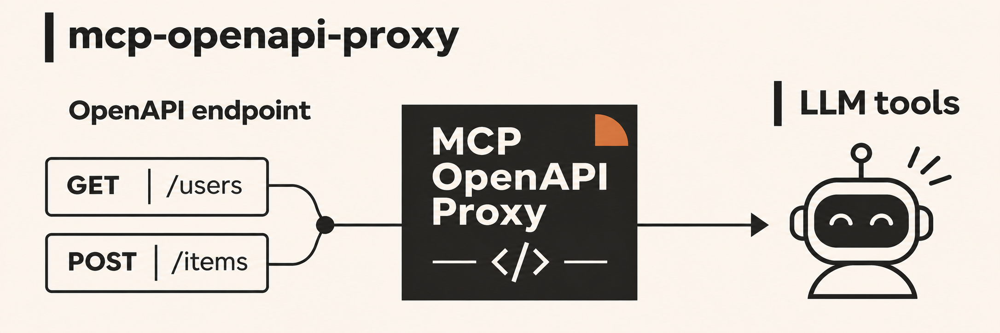
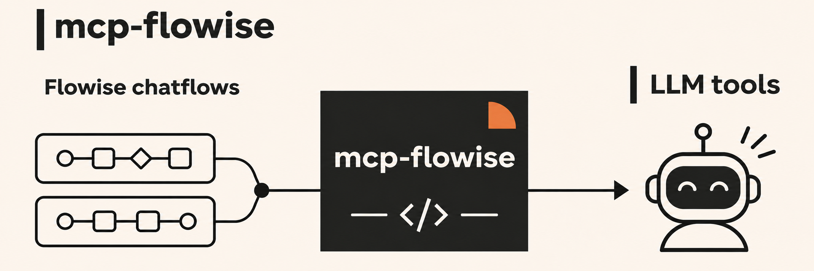
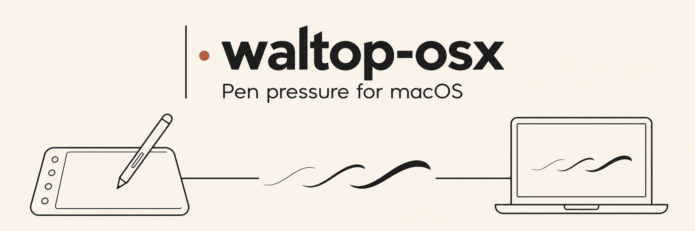
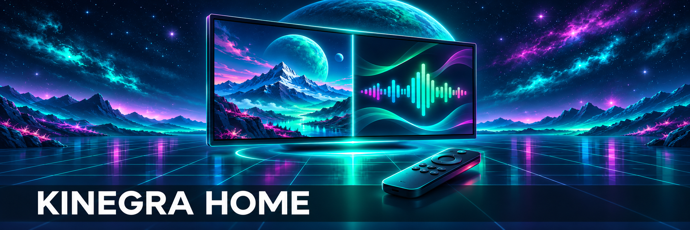

# Hey, I'm matthewh

I build local-first AI tools, agent workflows and useful apps, spanning speech, vision, automation and hardware integration.

My projects and integrations are listed first, followed by selected upstream contributions.

**Quick links:** [AI Infrastructure](#ai-infrastructure) · [Hardware & Input](#hardware--input) · [Android TV Apps](#android-tv-apps) · [Self-hosted Web Apps](#self-hosted-web-apps) · [Open-source contributions](#open-source-contributions)

## AI Infrastructure

Repo: [matthewhand/mcp-openapi-proxy](https://github.com/matthewhand/mcp-openapi-proxy)

OpenAPI-described REST APIs as MCP tools over Streamable HTTP or stdio.

---

Repo: [matthewhand/mcp-flowise](https://github.com/matthewhand/mcp-flowise)

Discover and run Flowise chatflows from MCP clients, with authentication and flow filtering.

---

Repo: [matthewhand/openai-f5-tts](https://github.com/matthewhand/openai-f5-tts)

Independent F5-TTS API wrapper for self-hosted speech, selectable voices, custom checkpoints, sentence-level PCM streaming and estimated timestamps.

---

Repo: [matthewhand/openai-kokoro-tts](https://github.com/matthewhand/openai-kokoro-tts)

Independent, CPU-first OpenAI-compatible speech API around Kokoro and kokoro-onnx.

---

Repo: [matthewhand/llama-stack-bridge](https://github.com/matthewhand/llama-stack-bridge)

Nginx/njs adapter for Llama Stack model lists and non-streaming chat.

 

## Hardware & Input

Repo: [matthewhand/open-wiimote](https://github.com/matthewhand/open-wiimote)

Wii Remote buttons and tilt as a virtual gamepad on Linux, with desktop and browser interfaces.

---

Repo: [matthewhand/waltop-osx](https://github.com/matthewhand/waltop-osx)

Userspace pen-pressure support for the WALTOP Slim Tablet 12.1 on macOS.

 

## Android TV Apps

Repo: [matthewhand/kinegra-home](https://github.com/matthewhand/kinegra-home)

Adjustable side-by-side Split View and remote session controls for NVIDIA SHIELD.

---

Repo: [matthewhand/kinegra-amp](https://github.com/matthewhand/kinegra-amp)

Music Assistant and local-file player with queues, audio-reactive visuals and optional webcam avatars.

 

## Self-hosted Web Apps

### [funes&#8209;vision](https://github.com/matthewhand/funes-vision)

Local watched-folder browser for JPEG snapshots and grouped visits, with a demo gallery.

---

### [operating&#8209;swarm](https://github.com/matthewhand/operating-swarm)

Agent workflows across model APIs, agent CLIs and remote harnesses, with an API, CLI and WebUI.

---

Repo: [matthewhand/trackie-assistant](https://github.com/matthewhand/trackie-assistant)

Save cloud music locally (currently Suno), then listen with your player of choice, like Music Assistant.

 

## Open-source contributions

### Merged upstream

| Project | Contribution |
|---|---|
| <h3><a href="https://github.com/open-webui/open-webui">Open&nbsp;WebUI</a></h3> | Added Qdrant Cloud API-key authentication. **Merged:** [#6954](https://github.com/open-webui/open-webui/pull/6954). |
| <h3><a href="https://github.com/open-webui/docs">Open&nbsp;WebUI&nbsp;Docs</a></h3> | HTTPS/Nginx setup, a RAG tutorial and a restructured Getting Started guide. **Merged:** [#257](https://github.com/open-webui/docs/pull/257), [#260](https://github.com/open-webui/docs/pull/260), [#266](https://github.com/open-webui/docs/pull/266). |

### Under review

| Project | Contribution |
|---|---|
| <h3><a href="https://github.com/scottmckenzie/holman-linux-python">Holman&nbsp;Linux&nbsp;SDK</a></h3> | BX2 MK1 discovery and dual-outlet control. **Open:** [#9](https://github.com/scottmckenzie/holman-linux-python/pull/9). |
| <h3><a href="https://github.com/CopilotKit/openmuse">OpenMuse</a></h3> | Contributed the local-persistence implementation in [#94](https://github.com/CopilotKit/openmuse/pull/94), now carried forward by another contributor in **open** continuation [#166](https://github.com/CopilotKit/openmuse/pull/166). |
| <h3><a href="https://github.com/emzimmer/server-wp-mcp">WordPress&nbsp;MCP</a></h3> | Added the package executable entry so the server can run directly from GitHub through npx. **Open:** [#5](https://github.com/emzimmer/server-wp-mcp/pull/5). |

See each repository and its upstream documentation for current setup, platform support and limitations. Models, dependencies and assets retain their own licence terms.

[Browse all public repositories](https://github.com/matthewhand?tab=repositories).
